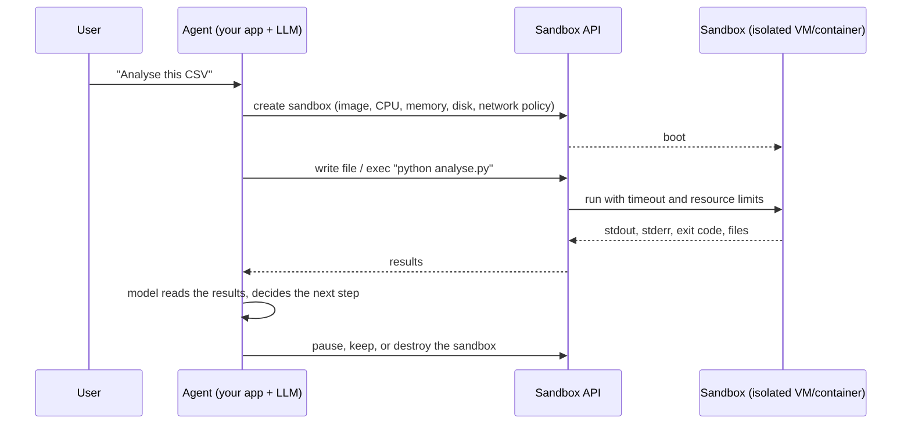

# AI Agent Sandbox Starter Pack (2026): Learn, Build & Secure AI Sandboxes

A practical, open-source guide to **AI agent sandboxes**: what they are, how they isolate code, and how to run AI-generated code safely. It covers isolation technologies, security controls, the sandbox lifecycle, and production patterns, with runnable **Python** and **TypeScript** examples you can use as a starting point.

- **Learn:** what an agent sandbox is, how it differs from a container or an agent harness, and how isolation actually works.
- **Build:** create a sandbox, execute untrusted code, connect an LLM agent to it, and run many sandboxes in parallel.
- **Secure:** threat models, network egress, secrets, resource limits, and multi-tenant design.

**Last reviewed:** 2026-10-21

> **Disclosure:** this repository is maintained by [Northflank](https://northflank.com/product/sandboxes). The runnable examples use Northflank Sandboxes; the concepts, guides and security advice apply to any provider, and the [provider directory](resources/sandbox-providers.md) lists the alternatives with links to their own docs. Corrections and examples for other providers are welcome via [pull request](CONTRIBUTING.md).

## Contents

- [What is an AI agent sandbox?](#what-is-an-ai-agent-sandbox)
- [How AI agent sandboxes work](#how-ai-agent-sandboxes-work)
- [Sandbox isolation technologies](#sandbox-isolation-technologies)
- [Create your first sandbox](#create-your-first-ai-agent-sandbox)
- [Tutorials and examples](#tutorials-and-examples)
- [Sandbox providers and tools](#ai-agent-sandbox-providers-and-tools)
- [Security and production best practices](#security-and-production-best-practices)
- [Common use cases](#common-sandbox-use-cases)
- [FAQ](#frequently-asked-questions)

## What is an AI agent sandbox?

**An AI agent sandbox is an isolated execution environment where an AI agent can run code, commands or tools, with controlled access to compute, the filesystem, the network and external services.**

Agents increasingly *act* rather than just answer: they write and run Python, install packages, call CLIs, edit repositories and drive browsers. That code is produced by a model, may be influenced by untrusted input (a web page, a README, a user prompt), and can be wrong in ways nobody predicted. A sandbox gives it a disposable machine to run on, so a mistake or a prompt injection damages the sandbox and not your servers, your data or other users.

The terms *agent*, *sandbox* and *harness* are often used interchangeably. They are different layers:

| Component | What it does | Example |
| --- | --- | --- |
| **AI agent** | Decides what to do next and calls tools to do it. The model plus its loop. | An LLM with a `run_code` tool |
| **Agent sandbox** | Provides the isolated environment where code and commands actually execute. | A microVM with Python installed, no access to your network |
| **Agent harness** | The runtime around an agent: tools, context management, permissions, orchestration, and often a sandbox to run in. | Claude Code, Codex CLI, a managed cloud harness |

A sandbox is infrastructure; it doesn't decide anything. The same sandbox can serve a code-interpreter chatbot, a coding agent, an evaluation pipeline or user-submitted code. If you want to run full coding agents such as Claude Code or Codex in the cloud, see the companion [cloud-coding-agent-starter-pack](https://github.com/northflank-examples/cloud-coding-agent-starter-pack).

Read more: [What is an agent sandbox (and when you don't need one)](guides/isolation-technologies.md#do-you-need-a-sandbox-at-all).

## How AI agent sandboxes work



Every sandbox platform implements the same five steps:

1. **Provision.** Create an isolated environment from an image, with fixed CPU, memory and disk. Boot time ranges from well under a second (pre-warmed microVMs) to tens of seconds (cold VMs, large images).
2. **Execute.** Send code or a shell command over an API. The sandbox runs it under a timeout and returns **stdout, stderr and the exit code**. Errors are data for the agent, not exceptions for your app.
3. **Exchange files.** Upload inputs and download artifacts (charts, reports, patched code).
4. **Manage the lifecycle.** Keep the sandbox for the next step, pause it to stop compute billing, or snapshot it.
5. **Clean up.** Destroy it, so leftover state, credentials and cost don't accumulate.

The important design rule: **the agent loop and its credentials stay outside the sandbox**. Your app holds the LLM API key and decides which tool calls to run; the sandbox only ever sees the code it's asked to execute. More in [Sandbox lifecycle](guides/sandbox-lifecycle.md).

## Sandbox isolation technologies

"Sandbox" describes a goal, not a technology. How strong the boundary is depends on what separates the untrusted code from the host kernel:

| Isolation approach | How it isolates | Strengths | Tradeoffs |
| --- | --- | --- | --- |
| **Containers** (Docker, runc) | Linux namespaces, cgroups, seccomp; **shares the host kernel** | Fast, cheap, universal tooling | A kernel bug or misconfiguration can mean container escape; needs careful hardening for untrusted code |
| **User-space kernels** (gVisor) | Intercepts syscalls with a kernel written in user space | Much smaller host attack surface, still container-like | Some syscall and performance overhead; occasional compatibility gaps |
| **MicroVMs** (Firecracker, Kata Containers, Cloud Hypervisor) | Hardware virtualisation; **each sandbox gets its own guest kernel** | VM-grade isolation with sub-second to seconds boot | More infrastructure to run; needs nested virtualisation or bare metal |
| **Full virtual machines** | Hardware virtualisation with a full OS | Strong, well-understood boundary | Slower to boot, more memory overhead |
| **WebAssembly / language runtimes** (Wasmtime, Pyodide) | Code runs inside a constrained runtime with no direct syscalls | Very lightweight, can run in-process or in a browser | Only supported languages and libraries; no arbitrary binaries or system tools |

For running arbitrary AI-generated or user-submitted code, most hosted platforms use **microVMs or gVisor**, not plain containers. But isolation strength depends on configuration and everything around it: a microVM with unrestricted network access and your production database password in its environment is not a safe sandbox.

Deep dive: [Isolation technologies explained](guides/isolation-technologies.md).

## Create your first AI agent sandbox

The shortest path from zero to running untrusted code in isolation:

1. **Choose a provider or runtime.** Hosted sandbox APIs (Northflank, E2B, Daytona, Modal, ...) or self-managed infrastructure (Firecracker, gVisor, Kata on your own Kubernetes). See [Choosing a sandbox provider](guides/choosing-a-sandbox-provider.md).
2. **Create an isolated sandbox.** Pick an image, CPU and memory, disk, and lifecycle settings.
3. **Execute code or commands.** Capture stdout, stderr and the exit code, under a timeout.
4. **Access files and results.** Write inputs, read back artifacts.
5. **Destroy or reuse it.** Clean up, or pause it to keep state for the next task.

In TypeScript, using the helper in [`examples/typescript/src/sandbox.ts`](examples/typescript/src/sandbox.ts):

```typescript
import { SandboxClient } from "./sandbox.js";

const client = await SandboxClient.fromEnv();          // NF_API_TOKEN, NF_PROJECT_ID
const sandbox = await client.create({ image: "python:3.12-slim" });
try {
  await sandbox.waitUntilReady();
  const result = await sandbox.runCode("python", "print(sum(range(10)))", { timeoutSeconds: 10 });
  console.log(result.exitCode, result.stdout);        // 0 "45\n"
} finally {
  await sandbox.destroy();
}
```

The same in Python, using [`examples/python/northflank_sandbox.py`](examples/python/northflank_sandbox.py):

```python
from northflank_sandbox import SandboxClient

with SandboxClient().create(image="python:3.12-slim") as sandbox:  # destroyed on exit
    sandbox.wait_until_ready()
    result = sandbox.run_python("print(sum(range(10)))", timeout_seconds=10)
    print(result.exit_code, result.stdout)
```

Step-by-step walkthrough with setup, expected output and common errors: **[Tutorial: Create your first sandbox](tutorials/create-your-first-sandbox/README.md)**.

## Tutorials and examples

| Tutorial | What you learn | Language | Status |
| --- | --- | --- | --- |
| [Create your first AI sandbox](tutorials/create-your-first-sandbox/README.md) | Provision a sandbox, run a command, clean up | TypeScript, Python | ✅ |
| [Execute AI-generated code safely](tutorials/execute-code-in-a-sandbox/README.md) | Run untrusted code, handle errors and runaway processes, read files | Python, TypeScript, JavaScript | ✅ |
| [Connect an AI agent to a sandbox](tutorials/connect-sandbox-to-agent/README.md) | Give an LLM a `run_code` tool that executes in a sandbox | TypeScript, Python | ✅ |
| [Manage the sandbox lifecycle](tutorials/manage-sandbox-lifecycle/README.md) | Create, pause, resume, resize and destroy; what survives a pause | TypeScript, Python | ✅ |
| [Run sandboxes in parallel](tutorials/run-sandboxes-in-parallel/README.md) | One sandbox per task, run concurrently, collect results, plan for rate limits | TypeScript, Python | ✅ |
| [Persist files between sessions](tutorials/persist-files-between-sessions/README.md) | Attach a volume, pause and resume, clean up safely | TypeScript, Python | ✅ |
| [Monitor sandbox resource usage](tutorials/monitor-sandbox-usage/README.md) | CPU and memory metrics, platform logs, a watchdog for runaway sandboxes | TypeScript, Python | ✅ |
| [Secure sandbox networking](tutorials/secure-sandbox-networking/README.md) | Protect exposed ports, probe egress, apply an egress allowlist with a network policy | TypeScript, Python | ✅ |

All runnable code lives in [`examples/`](examples/):

```bash
cd examples/typescript
npm install
cp .env.example .env        # NF_API_TOKEN, NF_PROJECT_ID (+ ANTHROPIC_API_KEY for the agent)
npm run first-sandbox       # create, exec, destroy
npm run run-code            # untrusted Python + JS: success, exception, infinite loop
npm run lifecycle           # pause / resume
npm run agent -- "Estimate pi with a Monte Carlo simulation"
npm run parallel            # three sandboxes at once
npm run persistent-volume   # volume survives pause/resume, /tmp doesn't
npm run monitoring          # CPU/memory metrics, logs, watchdog
npm run networking          # basic-auth public port + egress probe (-- --egress-policy)
npm run cleanup             # list (and with -- --yes, delete) leftover sbx-* sandboxes
```

## AI agent sandbox providers and tools

| Provider | Isolation | SDKs / interfaces | Run in your own cloud | Notes |
| --- | --- | --- | --- | --- |
| [Northflank](https://northflank.com/docs/v1/application/sandboxes/quickstart) | Kata Containers microVM (CPU); gVisor (GPU) | Python and JS/TS SDKs, REST API, CLI | Yes, self-serve BYOC (AWS, GCP, Azure, Oracle, CoreWeave, Civo, and more) | No time limit on how long a sandbox runs. Optional persistent volumes, GPU sandboxes, and public HTTPS ports |
| [E2B](https://docs.e2b.dev/) | Firecracker microVM | Python, JS/TS, CLI | Enterprise | Open-source runtime; pause/resume |
| [Daytona](https://www.daytona.io/docs) | Containers by default; optional VMs | Python, TypeScript, Ruby, Go, Java; CLI | Custom regions / own compute | Auto-stop after idle by default |
| [Modal Sandboxes](https://modal.com/docs/guide/sandboxes) | gVisor or VM runtime (Modal chooses if unset) | Python (plus JS and Go in beta) | No | Part of Modal's serverless platform |
| [Vercel Sandbox](https://vercel.com/docs/sandbox) | Firecracker microVM | TypeScript, Python, CLI | No | Session limits by plan |
| [Cloudflare Sandboxes (Containers + Sandbox SDK)](https://developers.cloudflare.com/sandbox/) | Cloudflare Containers (microVM); Dynamic Workers (isolates) | TypeScript (Workers) | No | Runs alongside Workers / Durable Objects |
| [Sprites (Fly.io)](https://docs.fly.io/sprites) | microVM | CLI, REST API; JS, Go, Python, Elixir SDKs | No | Persistent machines that pause when idle |

Self-managed building blocks: [Firecracker](https://github.com/firecracker-microvm/firecracker), [gVisor](https://gvisor.dev), [Kata Containers](https://katacontainers.io), and Kubernetes' [agent-sandbox](https://github.com/kubernetes-sigs/agent-sandbox) project. Full directory with use-case notes: **[resources/sandbox-providers.md](resources/sandbox-providers.md)**.

**What does a sandbox cost?** Roughly $0.07–$0.34 per hour for 2 vCPU / 4 GiB at list prices with the CPU fully busy; providers that bill only active CPU (Vercel, Cloudflare, Sprites) cost less when the sandbox is mostly idle. Rates, billing models and workload scenarios are maintained in the companion repo **[agent-sandbox-pricing](https://github.com/northflank-examples/agent-sandbox-pricing)**, so they aren't duplicated here.

## Security and production best practices

A sandbox doesn't make code safe by itself. Each control below reduces a specific risk; production systems layer several of them.

| Risk | Control |
| --- | --- |
| Code escapes to the host or other tenants | Strong isolation (microVM or gVisor), one sandbox per user or task, no privileged mode |
| Data exfiltration / prompt injection calling home | Default-deny network egress, allowlist only what the task needs |
| Credential theft | Keep LLM keys and cloud credentials **out** of the sandbox; inject narrowly scoped, short-lived tokens only when required |
| Runaway cost or denial of service | CPU/memory limits, per-command timeouts, maximum sandbox lifetime, concurrency caps |
| State leaking between users | Ephemeral sandboxes by default; destroy after use; never reuse a sandbox across tenants |
| Malicious output poisoning the agent | Truncate output, treat it as untrusted text, never `eval` it in your app |
| No trail after an incident | Log every command, exit code, network connection and file transfer with user and session IDs |

Full guides: **[Sandbox security](guides/sandbox-security.md)** · **[Networking and secrets](guides/networking-and-secrets.md)** · **[Lifecycle and persistence](guides/sandbox-lifecycle.md)**. Hands-on: [secure networking](tutorials/secure-sandbox-networking/README.md) · [monitoring and watchdogs](tutorials/monitor-sandbox-usage/README.md).

## Common sandbox use cases

| Use case | Example | Start here |
| --- | --- | --- |
| AI-generated code execution | Run Python an LLM wrote to answer a question | [Execute code tutorial](tutorials/execute-code-in-a-sandbox/README.md) |
| Code interpreter / data analysis | Calculations, CSV processing, charts | [Agent tutorial](tutorials/connect-sandbox-to-agent/README.md) |
| AI coding agents | Run commands and tests in an isolated workspace | [cloud-coding-agent-starter-pack](https://github.com/northflank-examples/cloud-coding-agent-starter-pack) |
| Browser automation | Run headless Chromium/Playwright under the agent's control | [Isolation guide](guides/isolation-technologies.md) (browsers need full Linux, not Wasm) |
| Automated testing | Test generated apps or pull requests before merge | [Parallel tutorial](tutorials/run-sandboxes-in-parallel/README.md) |
| Multi-agent workflows | Give each agent its own environment | [Parallel tutorial](tutorials/run-sandboxes-in-parallel/README.md) |
| Reinforcement learning and evals | Thousands of short, identical, disposable environments | [Parallel tutorial](tutorials/run-sandboxes-in-parallel/README.md) |
| User-submitted code | Online judges, notebooks, plugins | [Security guide](guides/sandbox-security.md) |

## Frequently asked questions

**What is an AI agent sandbox?**
An isolated environment (usually a microVM or hardened container) where an AI agent runs code and commands, with controlled access to compute, files, network and secrets. It contains the damage if the code is wrong or malicious.

**How does an AI sandbox work?**
Your application asks a sandbox API to create an environment, sends it code or commands to run, gets back stdout, stderr and an exit code, and destroys or pauses the environment when done. The agent's model and API keys stay in your application. See [How AI agent sandboxes work](#how-ai-agent-sandboxes-work).

**Why do AI agents need sandboxes?**
Because model-written code is untrusted. It can have bugs (deleting the wrong files, infinite loops), and prompt injection can steer an agent into running attacker-chosen commands. Running it on your own servers gives that code your permissions.

**What's the difference between an AI sandbox and a container?**
A container is a packaging and process-isolation mechanism that shares the host kernel. A sandbox is a security boundary; many are built from containers plus a stronger layer (gVisor or a microVM with its own kernel), plus network, resource and lifecycle controls. A plain Docker container isn't a strong boundary for hostile code. See [Isolation technologies](guides/isolation-technologies.md#containers-are-not-a-security-boundary-by-default).

**Are AI agent sandboxes secure?**
They reduce specific risks; none are secure by default in every configuration. Isolation technology, network egress policy, which secrets are present, resource limits and lifecycle all matter. See the [security guide](guides/sandbox-security.md).

**How do you execute AI-generated code safely?**
Run it in a fresh, isolated sandbox per user or task; deny network egress by default; keep credentials out; enforce timeouts and resource limits; truncate and treat the output as untrusted; and log everything. [Tutorial](tutorials/execute-code-in-a-sandbox/README.md).

**What are the best AI agent sandbox providers?**
It depends on isolation needs, languages, session length, persistence, GPU needs and whether you must run in your own cloud. Commonly used options include Northflank, E2B, Daytona, Modal, Vercel Sandbox, Cloudflare Sandbox and Sprites. Compare them in the [provider directory](resources/sandbox-providers.md) and [choosing a provider](guides/choosing-a-sandbox-provider.md).

**Can AI sandboxes access the internet?**
Usually yes by default, which is convenient (installing packages) and risky (data exfiltration). Production setups restrict egress to an allowlist or block it entirely. See [Networking and secrets](guides/networking-and-secrets.md) and the [secure networking tutorial](tutorials/secure-sandbox-networking/README.md).

**Can sandbox environments persist between sessions?**
Yes, with volumes, snapshots or pause/resume, depending on the provider. Ephemeral disk is usually lost when a sandbox stops. See [Lifecycle and persistence](guides/sandbox-lifecycle.md) and the [persistence tutorial](tutorials/persist-files-between-sessions/README.md).

**How much does an AI agent sandbox cost?**
At list prices, a 2 vCPU / 4 GiB sandbox costs roughly $0.07–$0.34 per hour with the CPU fully busy, plus storage and any plan fees. Providers that bill only active CPU cost less for mostly idle sandboxes. See [agent-sandbox-pricing](https://github.com/northflank-examples/agent-sandbox-pricing).

## Related Northflank resources

| Repository | Answers |
| --- | --- |
| **agent-sandbox-starter-pack** (this repo) | What are AI agent sandboxes, how do they work, and how do I build with them? |
| [agent-sandbox-pricing](https://github.com/northflank-examples/agent-sandbox-pricing) | How much do sandboxes cost, and how do providers compare? |
| [cloud-coding-agent-starter-pack](https://github.com/northflank-examples/cloud-coding-agent-starter-pack) | How do I run Claude Code, Codex and other coding agents in the cloud? |

More reading: [resources/further-reading.md](resources/further-reading.md).

## Contributing

Found an error, or want to add an example for another provider? See [CONTRIBUTING.md](CONTRIBUTING.md). Licensed under [MIT](LICENSE).
