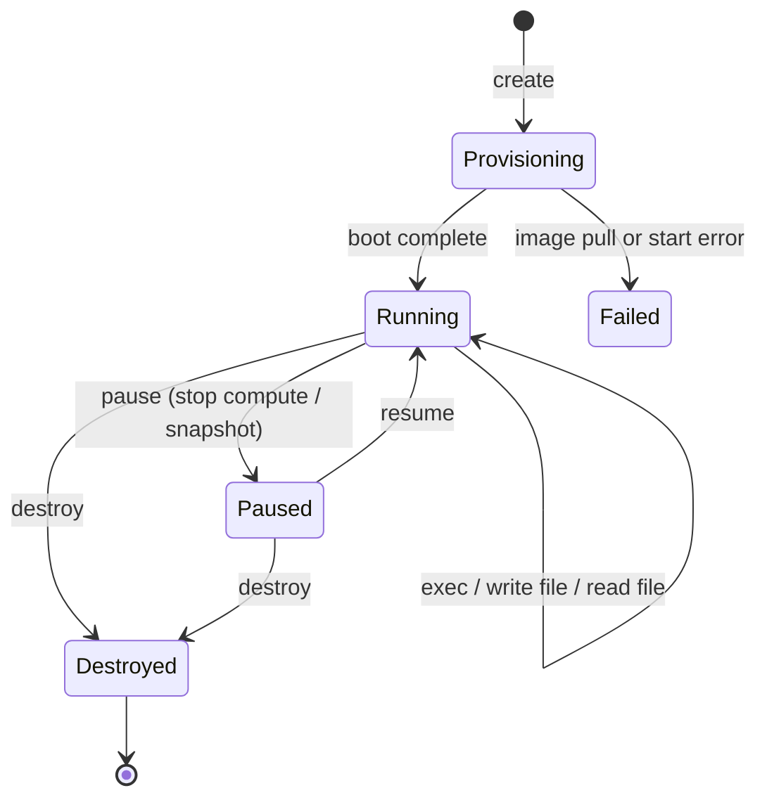

# Sandbox lifecycle and persistence

How AI agent sandboxes are created, used, paused, resumed and destroyed, what state survives each step, and how to choose between ephemeral and persistent sandboxes.

## Contents

- [The lifecycle](#the-lifecycle)
- [Ephemeral vs persistent sandboxes](#ephemeral-vs-persistent-sandboxes)
- [What survives what](#what-survives-what)
- [Lifecycle on Northflank, step by step](#lifecycle-on-northflank-step-by-step)
- [Making sandboxes start fast](#making-sandboxes-start-fast)
- [Cleaning up: timeouts and reapers](#cleaning-up-timeouts-and-reapers)
- [Choosing a lifecycle per use case](#choosing-a-lifecycle-per-use-case)

## The lifecycle



| Phase | What happens | Billing (typical) |
| --- | --- | --- |
| **Provision** | Allocate CPU/memory/disk, pull the image, boot the VM or container | Starts when running |
| **Run** | Execute commands, transfer files | Compute + disk |
| **Pause** | Stop compute; keep config and (if attached) persistent storage | Storage only |
| **Resume** | Boot again, reattach storage | Compute again |
| **Destroy** | Delete everything, including ephemeral disk | Stops (delete volumes separately if needed) |

## Ephemeral vs persistent sandboxes

| | Ephemeral | Persistent |
| --- | --- | --- |
| Lives for | One task or request | A session, a project, days or weeks |
| State | Lost on destroy (and usually on pause/restart) | Kept on a volume or snapshot |
| Security | Strongest: nothing carries over between tasks | Must protect the stored state; scope it to one user |
| Cost | Pay only while working | Pay for storage while idle, compute while running |
| Good for | Code interpreters, evals, RL, CI, untrusted user code | Coding agents, notebooks, long-running research, dev environments |

**Default to ephemeral.** Add persistence only for state the user actually needs to come back to, and keep it scoped to that user.

## What survives what

| Event | Ephemeral disk (`/tmp`, container FS) | Attached volume | Running processes | Configuration |
| --- | --- | --- | --- | --- |
| Command finishes | ✅ | ✅ | Only background ones | ✅ |
| Pause | ❌ | ✅ | ❌ | ✅ |
| Restart / crash | ❌ | ✅ | ❌ | ✅ |
| Destroy | ❌ | Depends: deleted only if you delete it | ❌ | ❌ |

This table describes container- and Kubernetes-style platforms such as Northflank. Platforms with **memory snapshots** (some Firecracker-based providers) can also preserve running processes and in-memory state across a pause; check your provider's docs. [`03-lifecycle.ts`](../examples/typescript/src/03-lifecycle.ts) and [`lifecycle.py`](../examples/python/lifecycle.py) demonstrate the ephemeral-disk row on Northflank.

## Lifecycle on Northflank, step by step

On Northflank a sandbox is a **deployment service**. On the managed cloud it runs in a Kata Containers microVM by default. Using the [JS client](https://www.npmjs.com/package/@northflank/js-client) (the [Python SDK](https://northflank.com/docs/v1/api/use-the-python-client) mirrors these calls with snake_case keyword arguments such as `project_id` and `service_id`, and request bodies passed as `data=` keep the API's camelCase field names; exec and file copy are `exec.run_service_command` / `exec.open_service_session` and `files.upload` / `files.download`):

**Create** (an image plus a long-running command so you can exec into it):

**TypeScript**

```typescript
await apiClient.create.service.deployment({
  parameters: { projectId },
  data: {
    name: sandboxId,
    billing: { deploymentPlan: "nf-compute-20" },      // 0.2 vCPU / 512 MB
    deployment: {
      instances: 1,
      external: { imagePath: "python:3.12-slim" },
      docker: { configType: "customCommand", customCommand: "sleep infinity" },
      storage: { ephemeralStorage: { storageSize: 2048 } },  // MB
    },
  },
});
```

**Wait until ready.** Poll `get.service` until `status.deployment.status === "COMPLETED"`. On Northflank `COMPLETED` means *rolled out and running*, not *exited*. `FAILED` means it didn't start.

**Execute:**

**TypeScript**

```typescript
const r = await apiClient.exec.execServiceCommand(
  { projectId, serviceId: sandboxId },
  { command: "timeout -s KILL 30 python3 main.py", shell: "sh -c" },
);
// r.stdOut, r.stdErr, r.commandResult.exitCode
```

For long-running or interactive processes, `exec.execServiceSession` gives you stdin/stdout/stderr streams. For files, use `upload.service.files` / `download.service.files` (the image needs `tar`), or the CLI's `northflank upload|download service file`.

**Pause and resume** with the dedicated endpoints. Pausing stops compute billing and ends running processes; configuration and attached volumes are kept:

**TypeScript**

```typescript
await apiClient.pause.service({ parameters: { projectId, serviceId: sandboxId } });
// Pausing settles asynchronously: wait until it reports paused before resuming,
// or the resume can race the pause (see Sandbox.pause() in examples/typescript/src/sandbox.ts).
await apiClient.resume.service({ parameters: { projectId, serviceId: sandboxId }, data: {} });
// then poll until status.deployment.status === "COMPLETED" again
```

Scaling to zero instances has the same billing effect, but `pause` states the intent and is what the dashboard and CLI use. To change CPU and memory, scale to a different plan: `scale.service({ ..., data: { deploymentPlan: "nf-compute-400" } })` (the sandbox restarts).

**Persist state** across pauses with a volume. Create it first and attach it at creation time (attaching later with `attach.volume` redeploys the sandbox and wipes its ephemeral disk):

**TypeScript**

```typescript
await apiClient.create.volume({
  parameters: { projectId },
  data: {
    name: `data-${sandboxId}`,
    mounts: [{ containerMountPath: "/workspace" }],
    spec: { accessMode: "ReadWriteMany", storageClassName: "nf-multi-rw", storageSize: 10240 },
  },
});
// then, in create.service.deployment's data:
//   createOptions: { volumesToAttach: [`data-${sandboxId}`] }
```

**Destroy.** `delete.service` removes the sandbox. A volume is a separate resource that outlives the sandbox and can't be deleted while attached: `detach.volume`, then `delete.service`, then `delete.volume` (retry on `409` while the detach settles). Deleting a volume is irreversible.

Hands-on: [Tutorial: Manage the sandbox lifecycle](../tutorials/manage-sandbox-lifecycle/README.md) · [Tutorial: Persist files between sessions](../tutorials/persist-files-between-sessions/README.md).

Full reference: [Northflank sandboxes quickstart](https://northflank.com/docs/v1/application/sandboxes/quickstart) · [Configure and manage sandboxes](https://northflank.com/docs/v1/application/sandboxes/configure-and-manage-sandboxes). Every call above has a Python equivalent in the [Python SDK](https://northflank.com/docs/v1/api/use-the-python-client) (`client.pause.service(project_id=..., service_id=...)`, and so on).

## Making sandboxes start fast

Agents often wait on sandbox creation, so startup time is user-facing latency.

- **Small images.** Pulling a 3 GB image dominates boot time. Use slim bases; pre-install packages instead of installing them per task.
- **Pin and pre-pull.** The same image tag on every sandbox lets nodes cache it.
- **Create early.** Start provisioning when the user opens a session or when the model *starts* generating code, not when it finishes.
- **Warm pools.** Keep N ready sandboxes and hand each one out **once** (never reuse across users). Refill the pool in the background.
- **Pause instead of destroy** for a session the same user will return to, if your platform resumes faster than it creates.

## Cleaning up: timeouts and reapers

Leaked sandboxes cost money and are an attack surface. Use several layers:

1. `try/finally` (or a context manager) around every sandbox your code creates. All examples here do.
2. A **per-command timeout** inside the sandbox.
3. An **idle timeout and maximum lifetime** per sandbox, enforced by your orchestrator or provider.
4. A **reaper**: a scheduled job that lists sandboxes by name prefix or tag and deletes anything older than the maximum lifetime. [`cleanup.ts`](../examples/typescript/src/cleanup.ts) is the manual version; on Northflank you could run the same logic as a cron job.

## Choosing a lifecycle per use case

| Use case | Lifecycle |
| --- | --- |
| Chat code interpreter | One sandbox per conversation, destroyed after idle timeout |
| Single tool call ("run this snippet") | Ephemeral per call, from a warm pool |
| Coding agent on a repo | Persistent per user/repo with a volume; pause when idle |
| Evals / RL rollouts | Ephemeral, massively parallel, identical images |
| CI for generated PRs | Ephemeral per PR run |
| User-submitted code in a product | Ephemeral per submission, strict limits, no network |
