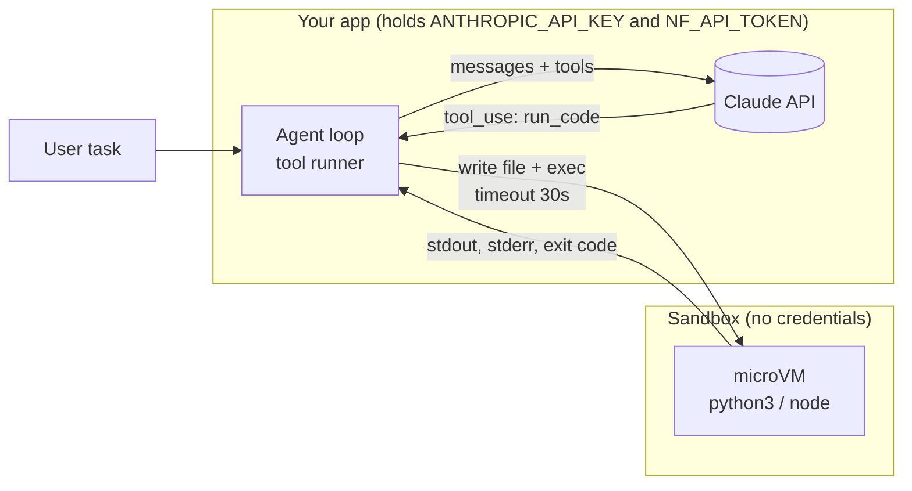

# Tutorial: Connect an AI agent to a sandbox

A model that can only talk has to guess at anything that needs computing. Give it a tool that runs code, and it can work answers out instead. In this tutorial you'll connect an LLM to a sandbox: the model writes a program, the sandbox runs it, the result goes back to the model, and it keeps going until it has an answer.

**You'll learn:**
- how to split an agent between your app and a sandbox so your API keys never reach the sandbox
- how to describe a `run_code` tool so the model uses it well
- how to return results, including failures, so the model can fix its own code
- how to run the agent loop and bound its cost
- how to clean up when the conversation ends

This tutorial uses Claude through the Anthropic SDK's tool runner, in TypeScript and Python, but the pattern works with any model or framework that supports tool calling: **a tool whose implementation is "run this in the sandbox".** The finished scripts are [`04-agent.ts`](../../examples/typescript/src/04-agent.ts) and [`agent.py`](../../examples/python/agent.py).

**Prerequisites:** [Create your first sandbox](../create-your-first-sandbox/README.md) and [Execute AI-generated code safely](../execute-code-in-a-sandbox/README.md), plus an [Anthropic API key](https://platform.claude.com/settings/keys).

## Step 1: Decide where each part runs

An agent with a sandbox has two halves:



- **The agent loop runs in your app.** It holds the API keys, talks to the model, and decides which tool calls to carry out.
- **The sandbox only receives code.** If a prompt injection convinces the model to run `env` or `curl attacker.example`, there are no keys to find.

Keep this split whatever framework you use. An agent loop running *inside* the sandbox would put your API key next to the code it's running.

## Step 2: Start one sandbox per conversation

Create the sandbox when the conversation starts and reuse it for every tool call in that conversation. Files the model writes in one call are still there in the next, so it can build on earlier work. Never share a sandbox between users.

**TypeScript**

```typescript
import { SandboxClient } from "./sandbox.js";

const sandboxes = await SandboxClient.fromEnv();
const sandbox = await sandboxes.create({
  image: "nikolaik/python-nodejs:python3.12-nodejs22-slim",   // Python and Node.js
});
await sandbox.waitUntilReady();   // inside the try block from step 6
```

**Python**

```python
from northflank_sandbox import SandboxClient

sandboxes = SandboxClient()
sandbox = sandboxes.create(image="nikolaik/python-nodejs:python3.12-nodejs22-slim")  # Python and Node.js
sandbox.wait_until_ready()  # inside the try block from step 6
```

## Step 3: Describe the tool

The model decides when and how to use a tool from its name, description and input schema, so the description should tell it what the environment is like: which languages run, that files persist, how to get output back, and the time limit.

**TypeScript**

```typescript
import { betaZodTool } from "@anthropic-ai/sdk/helpers/beta/zod";
import { z } from "zod";

const runCode = betaZodTool({
  name: "run_code",
  description:
    "Execute a Python or JavaScript program in an isolated Linux sandbox. Returns " +
    "its stdout, stderr and exit code. The sandbox persists for this conversation, so " +
    "files written under /tmp/agent are available to later calls. Print anything you " +
    "need to see. Each run is killed after 30 seconds.",
  inputSchema: z.object({
    language: z.enum(["python", "javascript"]),
    code: z.string().describe("The complete program to run."),
  }),
  run: async ({ language, code }) => runInSandbox(language, code),
});
```

In Python, `@beta_tool` builds an equivalent schema from the function's type hints and docstring. `Literal["python", "javascript"]` becomes the list of allowed languages, and the `Args:` section becomes the field descriptions:

```python
from typing import Literal
from anthropic import beta_tool

@beta_tool
def run_code(language: Literal["python", "javascript"], code: str) -> str:
    """Execute a Python or JavaScript program in an isolated Linux sandbox.

    Returns its stdout, stderr and exit code. The sandbox persists for this
    conversation, so files written under /tmp/agent are available to later calls.
    Print anything you need to see. Each run is killed after 30 seconds.

    Args:
        language: The language of the program.
        code: The complete program to run.
    """
    return run_in_sandbox(language, code)
```

`betaZodTool` turns the Zod schema into the JSON schema the API expects, and checks the model's input against it before `run` is called.

## Step 4: Run the code and report back

The tool's implementation is the function from [Execute AI-generated code safely](../execute-code-in-a-sandbox/README.md): write the code to a file, run it with a timeout, then describe what happened. Two rules make the difference between an agent that recovers and one that gets stuck:

- **Return failures as results, don't throw them.** A traceback is exactly what the model needs to fix its code.
- **Truncate the output.** A program that prints a huge array would otherwise fill the model's context.

**TypeScript**

```typescript
const MAX_OUTPUT_CHARS = 10_000;
const truncate = (s: string) =>
  s.length > MAX_OUTPUT_CHARS
    ? `${s.slice(0, MAX_OUTPUT_CHARS)}\n...[truncated ${s.length - MAX_OUTPUT_CHARS} chars]`
    : s;

async function runInSandbox(language: "python" | "javascript", code: string) {
  const r = await sandbox.runCode(language, code, { timeoutSeconds: 30 });
  const status = r.timedOut ? "timed out after 30s" : `exit code ${r.exitCode}`;
  return `status: ${status}\nstdout:\n${truncate(r.stdout)}\nstderr:\n${truncate(r.stderr)}`;
}
```

**Python**

```python
MAX_OUTPUT_CHARS = 10_000

def truncate(s: str) -> str:
    if len(s) > MAX_OUTPUT_CHARS:
        return f"{s[:MAX_OUTPUT_CHARS]}\n...[truncated {len(s) - MAX_OUTPUT_CHARS} chars]"
    return s

def run_in_sandbox(language: str, code: str) -> str:
    r = sandbox.run_code(language, code, timeout_seconds=30)
    status = "timed out after 30s" if r.timed_out else f"exit code {r.exit_code}"
    return f"status: {status}\nstdout:\n{truncate(r.stdout)}\nstderr:\n{truncate(r.stderr)}"
```

## Step 5: Run the agent loop

The tool runner handles the loop: it sends the task, runs each tool call the model makes, sends back the results, and stops when the model gives a final answer. Set `max_iterations` so a model that keeps retrying can't run up an unbounded bill.

**TypeScript**

```typescript
import Anthropic from "@anthropic-ai/sdk";

const anthropic = new Anthropic();   // reads ANTHROPIC_API_KEY

const final = await anthropic.beta.messages.toolRunner({
  model: "claude-opus-5-5",
  max_tokens: 16000,
  max_iterations: 10,
  system:
    "You are a data assistant. Use the run_code tool to compute answers instead of " +
    "estimating them. Keep programs short and print the results you need.",
  tools: [runCode],
  messages: [{ role: "user", content: "Estimate pi from 10,000 random points." }],
});

const answer = final.content.filter((b) => b.type === "text").map((b) => b.text).join("\n");
```

**Python**

```python
import anthropic

client = anthropic.Anthropic()  # reads ANTHROPIC_API_KEY

runner = client.beta.messages.tool_runner(
    model="claude-opus-5-5",
    max_tokens=16000,
    max_iterations=10,
    system=(
        "You are a data assistant. Use the run_code tool to compute answers instead of "
        "estimating them. Keep programs short and print the results you need."
    ),
    tools=[run_code],
    messages=[{"role": "user", "content": "Estimate pi from 10,000 random points."}],
)
final = runner.until_done()

answer = "\n".join(block.text for block in final.content if block.type == "text")
```

The system prompt tells the model to compute rather than guess. Without it, a model may answer from memory and never call the tool. The example scripts also enable the API's server-side refusal fallback, and check `stop_reason` before reading the answer: `"refusal"` means the model declined, and `"tool_use"` means the run hit `max_iterations` before the model gave a final answer.

## Step 6: Clean up when the conversation ends

Wrap everything after `create`, from the wait in step 2 through step 5, in `try`, and destroy the sandbox in `finally`, so it's removed even if the sandbox fails to start or the model call fails:

**TypeScript**

```typescript
try {
  // wait for the sandbox, define the tool and run the agent loop
} finally {
  await sandbox.destroy();
}
```

**Python**

```python
try:
    pass  # wait for the sandbox and run the agent loop
finally:
    sandbox.destroy()
```

For conversations that span hours or days, pause the sandbox between turns instead, and keep files on a volume ([Persist files between sessions](../persist-files-between-sessions/README.md)).

## Run the complete example

**TypeScript:** add `ANTHROPIC_API_KEY` to `examples/typescript/.env`, then:

```bash
cd examples/typescript
npm run agent -- "Generate 10,000 random points in the unit square and use them to estimate pi."
```

**Python:** `requirements.txt` includes the Anthropic SDK.

```bash
cd examples/python
export ANTHROPIC_API_KEY=...
python agent.py "Generate 10,000 random points in the unit square and use them to estimate pi."
```

Try others:

```bash
npm run agent -- "What is the 200th prime number, and how many primes are below 100,000?"
python agent.py "Write a CSV of 50 fake sales records to /tmp/agent/sales.csv, then report revenue by region."
```

Expected output:

```
Sandbox sbx-9a8b7c6d starting...

--- run_code (python) ---
import random
inside = sum(1 for _ in range(10_000) if random.random()**2 + random.random()**2 <= 1)
estimate = 4 * inside / 10_000
import math
print(estimate, abs(estimate - math.pi))

--- exit code 0 ---
3.1428 0.0012073464102067

=== Answer ===
The Monte Carlo estimate with 10,000 points was 3.1428, about 0.0012 away from π ...

Destroyed sbx-9a8b7c6d
```

Illustrative output: the model's code, numbers and sandbox IDs differ on every run.

## Adapting it

- **Other models or frameworks:** keep `runInSandbox` / `run_in_sandbox` and wrap it in your framework's tool type (OpenAI function calling, LangChain/LangGraph tools, Vercel AI SDK tools, an MCP server).
- **A shell tool** instead of `run_code`: expose `sandbox.exec(command)` directly. More flexible, and more important to lock down egress ([Secure sandbox networking](../secure-sandbox-networking/README.md)).
- **Files in and out:** add `upload_file` / `read_file` tools backed by the helpers' file methods (`writeFile` / `readFile`, or `write_file` and `exec("cat <path>")` in Python).
- **Human approval:** gate risky tools inside the tool function and return "user declined" when not approved.

## Common errors

| Symptom | Fix |
| --- | --- |
| `Could not resolve authentication method` | Set `ANTHROPIC_API_KEY` (in `.env` for TypeScript, or in your environment for Python) |
| The model answers without calling the tool | Make the system prompt and tool description say to compute rather than estimate |
| Tool results show `timed out after 30s` repeatedly | Raise `timeoutSeconds` / `timeout_seconds` and update the 30-second limit in the tool description and status message, or use a larger compute plan |
| `sbx-*` sandbox left behind after Ctrl+C | `npm run cleanup -- --yes` (from `examples/typescript`) |

## Next

- [Persist files between sessions](../persist-files-between-sessions/README.md): keep an agent's workspace across conversations.
- [Secure sandbox networking](../secure-sandbox-networking/README.md): control what the agent's code can reach.
