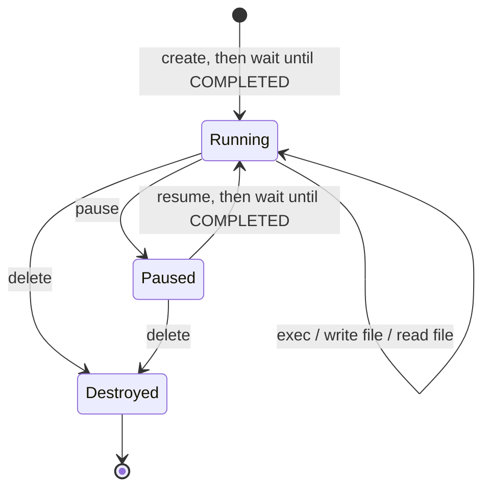

# Tutorial: Manage the sandbox lifecycle

A sandbox that runs while nobody is using it costs money; one you delete too early takes the user's work with it. In this tutorial you'll take a sandbox through its whole lifecycle (create, use, pause, resume, resize, destroy) and see exactly what survives each step, so you can choose when to pause, when to delete, and what to keep.

**You'll learn:**
- the states a sandbox moves through
- how to pause a sandbox to stop compute billing, and resume it
- what survives a pause and what doesn't
- how to give a sandbox more CPU and memory
- how to make sure sandboxes are always destroyed

**Prerequisite:** [Create your first sandbox](../create-your-first-sandbox/README.md). The API token's role also needs Project → Services → General → Update for pause, resume and scale. The finished scripts are [`03-lifecycle.ts`](../../examples/typescript/src/03-lifecycle.ts) and [`lifecycle.py`](../../examples/python/lifecycle.py). For the concepts behind each state, see the [Sandbox lifecycle guide](../../guides/sandbox-lifecycle.md).

## Step 1: Know the states



| State | Compute billed | Configuration | Ephemeral disk (everything not on a volume, e.g. `/tmp`) | Attached volume |
| --- | --- | --- | --- | --- |
| Running | Yes | Kept | Kept | Kept |
| Paused | No | Kept | Wiped | Kept (and billed) |
| Destroyed | No | Gone | Gone | Kept until you delete it |

## Step 2: Create a sandbox and leave some state

Create a sandbox, wait for it, and write a file to its ephemeral disk so you can see what happens to it later:

**TypeScript**

```typescript
import { SandboxClient } from "./sandbox.js";

const client = await SandboxClient.fromEnv();
const { api, projectId } = client;
const sandbox = await client.create();
await sandbox.waitUntilReady();
await sandbox.writeFile("/tmp/agent/state.txt", "written before pause");
```

**Python**

```python
from northflank_sandbox import SandboxClient

client = SandboxClient()
api, project_id = client.api, client.project_id
sandbox = client.create()
sandbox.wait_until_ready()
sandbox.write_file("/tmp/agent/state.txt", "written before pause")
```

## Step 3: Pause the sandbox

Pause a sandbox when the user steps away. Pausing stops compute billing and ends running processes and terminal sessions; the configuration is kept, and so is any attached volume.

Pausing finishes in the background, so wait until the sandbox reports that it's paused before you resume it, or the resume can race the pause:

**TypeScript**

```typescript
await api.pause.service({ parameters: { projectId, serviceId: sandbox.id } });
// The helper's sandbox.pause() makes this call, then polls get.service until
// the sandbox reports it is paused.
```

**Python**

```python
api.pause.service(project_id=project_id, service_id=sandbox.id)
api.helpers.wait_for_service_paused(project_id=project_id, service_id=sandbox.id)
```

## Step 4: Resume it

Resume when the user comes back, then wait for the sandbox to report `COMPLETED` again before running commands. Resuming a sandbox that isn't paused returns an error, so only resume one you paused.

**TypeScript**

```typescript
await api.resume.service({ parameters: { projectId, serviceId: sandbox.id }, data: {} });
await sandbox.waitUntilReady();
```

**Python**

```python
api.resume.service(project_id=project_id, service_id=sandbox.id, data={})
sandbox.wait_until_ready()
```

`data` can be empty, or carry settings to change as the sandbox comes back up.

## Step 5: Check what survived

Read the file you wrote in step 2:

**TypeScript**

```typescript
const check = await sandbox.exec("cat /tmp/agent/state.txt");
console.log(check.exitCode === 0 ? "survived" : "gone");   // gone
```

**Python**

```python
check = sandbox.exec("cat /tmp/agent/state.txt")
print("survived" if check.exit_code == 0 else "gone")      # gone
```

The file is gone: ephemeral storage is wiped when a sandbox pauses. Anything that must survive a pause belongs on a volume ([Persist files between sessions](../persist-files-between-sessions/README.md)), or should be copied out before pausing.

## Step 6: Give it more CPU and memory

If an agent's task needs more resources, scale the sandbox to a bigger plan. The sandbox restarts to pick up the new plan, so expect a short interruption, and the ephemeral disk is wiped again:

**TypeScript**

```typescript
await api.scale.service({
  parameters: { projectId, serviceId: sandbox.id },
  data: { deploymentPlan: "nf-compute-50" },   // 0.5 vCPU / 1 GB
});
await sandbox.waitUntilReady();
```

**Python**

```python
api.scale.service(
    project_id=project_id,
    service_id=sandbox.id,
    data={"deploymentPlan": "nf-compute-50"},  # 0.5 vCPU / 1 GB
)
sandbox.wait_until_ready()
```

The [plans list](https://northflank.com/pricing) shows the CPU, memory and price of each plan. (The finished scripts skip this step to keep them quick.)

## Step 7: Destroy it

When the work is done, delete the sandbox. Do it in a `finally` block so it happens even when a step fails. In Python, the helper also works as a context manager: `with client.create() as sandbox:` deletes the sandbox when the block exits.

**TypeScript**

```typescript
try {
  // steps 2-6
} finally {
  await sandbox.destroy();   // api.delete.service(...)
}
```

**Python**

```python
try:
    pass  # steps 2-6
finally:
    sandbox.destroy()   # api.delete.service(...)
```

Deleting a sandbox doesn't delete its volumes: a volume is a separate resource you delete yourself ([how](../persist-files-between-sessions/README.md#step-7-clean-up-in-the-right-order)).

## Run the complete example

The finished scripts run steps 2–5 and 7:

```bash
cd examples/typescript && npm run lifecycle
# or
cd examples/python && python lifecycle.py
```

Expected output:

```
Created sbx-2d7e9a01
Wrote /tmp/agent/state.txt to ephemeral disk
Pausing. Compute billing stops while paused...
Resuming...
Resumed in X.Xs
File is gone: ephemeral disk does not survive a pause. Attach a volume to persist state (tutorials/persist-files-between-sessions).
Destroyed sbx-2d7e9a01
```

Illustrative output: IDs and timings will differ.

## When to pause and when to destroy

| Situation | Do this |
| --- | --- |
| User is away for a while, and will come back to the same workspace | Pause (keep work on a volume) |
| Task is finished and nothing needs keeping | Destroy |
| Short code-interpreter calls | Destroy after each conversation |
| Long-running coding agent | Pause between sessions, with a volume |

## Common errors

| Symptom | Cause | Fix |
| --- | --- | --- |
| Error when resuming | The sandbox isn't paused | Check its state first, and only resume a sandbox you paused |
| Commands fail right after resuming or scaling | The sandbox isn't running yet | Wait until the deployment reports `COMPLETED` |
| Files missing after resume | They were on ephemeral disk | Keep them on a volume, or copy them out before pausing |
| `sbx-*` sandbox left behind after Ctrl+C | Script interrupted before cleanup | `npm run cleanup -- --yes` (from `examples/typescript`) |

Northflank docs: [Configure and manage sandboxes](https://northflank.com/docs/v1/application/sandboxes/configure-and-manage-sandboxes).

## Next

- [Persist files between sessions](../persist-files-between-sessions/README.md): keep work across pauses with a volume.
- [Run sandboxes in parallel](../run-sandboxes-in-parallel/README.md)
